# 知音 · AI 内容营销系统 —— 图文使用手册

> 适用版本：v0.2.54 及以上（Windows 桌面端；界面由随包本地服务提供，本机浏览器打开同一地址即可看到同一套界面）
> 更新于：2026-09-18
> 配图说明：每张配图下方的表格按「从左到右、从上到下」的顺序说明各功能区域的位置与用途。
> 产品名说明：安装包与关于信息里的产品名为 **Bosom Friend**，界面左上角品牌名为 **Bosom Friend**，本手册标题沿用中文品牌「知音」。

---

## 1. 快速上手：安装与启动

### 1.1 运行环境

| 项 | 要求 |
|---|---|
| 操作系统 | **Windows 10 / 11 64 位**。安装包内的 Electron、Node、Python、Chromium 全部是 64 位，32 位系统无法运行。 |
| 磁盘 | 安装约 1.1 GB；首次启动解压随包内核运行时另需约 1 GB 用户数据空间。 |
| 内存 | 建议 8 GB 以上（视频生成与浏览器自动化会同时占用较多内存）。 |
| 网络 | 首次配置模型、生成内容、发布与同步都需要联网。 |

安装过程会自动检测并开启 Windows 长路径支持（一次管理员授权，装完即用，无需手动改系统设置）；安装器自带解压器，不依赖系统自带解压工具，也不依赖系统设置。

### 1.2 启动页：看得见的启动过程

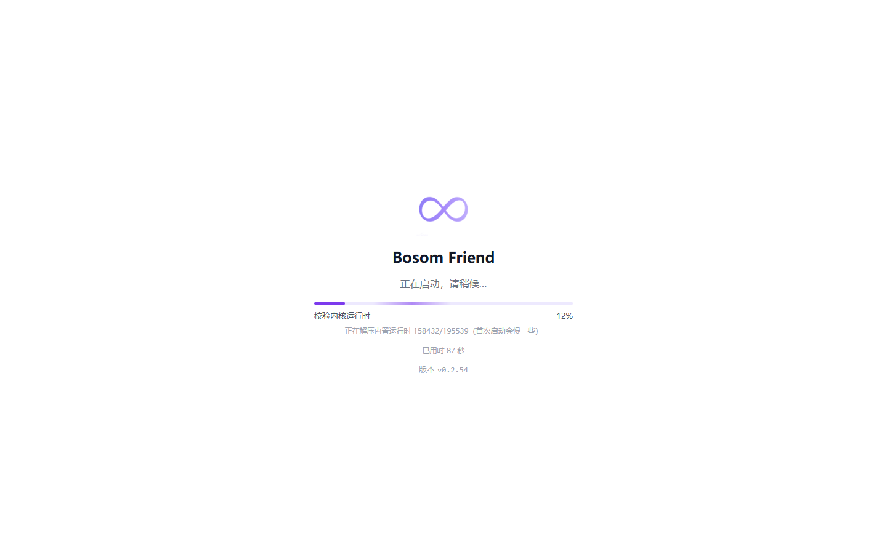

| 编号 | 区域 | 说明 |
|---|---|---|
| ① | 品牌与提示 | 「Bosom Friend · 正在启动，请稍候…」，启动失败时会换成真实原因 |
| ② | 进度条 | 填充长度永远等于真实进度；测不出长度的阶段只额外叠一条扫光，不会把 6% 画成满格 |
| ③ | 阶段名与百分比 | 五个真实阶段：检查运行环境 → 清理旧版运行时残留 → 校验内核运行时 → 启动内核服务 → 加载产品界面；百分比只在真实里程碑推进 |
| ④ | 阶段细节 | 例如「正在解压内置运行时 158432/195539」，首次启动才出现 |
| ⑤ | 已用时 | 低配机器上「等了多久」比百分比更能说明问题，如实显示 |
| ⑥ | 版本号 | 当前安装版本，例如 v0.2.54 |

- **低配机型自动适配**：逻辑核心数 ≤4 或物理内存 ≤8GB 的电脑自动进入「低配模式」——内核内存上限按内存夹取、备份保留份数 30→10、接待引擎轮询间隔 10→20 分钟、关闭前端重特效、启动等待上限放宽到 240 秒，启动页会如实标注「低配模式」。
- 标准机首次冷启动因系统安全扫描通常需要 1～3 分钟，低配机最长约 4 分钟；之后启动会明显变快（内核运行时已解压完成）。
- 若启动失败，启动页会显示真实原因，并提供「重试启动 / 完全退出」两个出口；如提示「内核运行时缺失，请重新运行安装包」，重新运行安装包即可完成修复安装，无需重装系统或手动改配置。

### 1.3 主界面布局

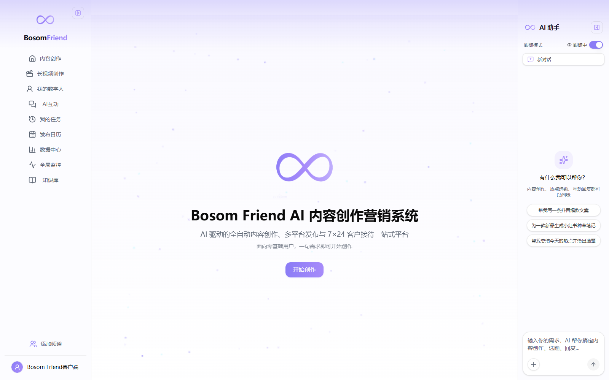

| 编号 | 区域 | 说明 |
|---|---|---|
| ① | 左侧导航栏 | 九大功能入口：内容创作、长视频创作、我的数字人、AI互动、我的任务、发布日历、数据中心、全局监控、知识库 |
| ② | 首页主区 | 主标题「Bosom Friend AI 内容创作营销系统」＋「开始创作」按钮、精选示例与关键特性介绍 |
| ③ | 右侧 AI 助手 | 常驻面板，随时向 AI 提问（详见第 14 节） |
| ④ | 添加频道 | 绑定平台账号并打开频道管理（详见第 6 节） |
| ⑤ | Bosom Friend 客户端 | 底部用户入口：联系我们 / 消息通知（含更新日志）/ 设置 |

核心链路是 **AI 创作 → 草稿 → 多平台发布 → 数据复盘 → 自动接待**：内容与长视频在左侧前两项产出，账号与接待在「全局监控」与「添加频道」里配置，数据回流在「数据中心 / 发布日历」查看。

---

## 2. 内容创作：一句话生成图文 / 短视频

点击左侧「内容创作」进入。页面顶部两个标签：**创作 / 素材库**。

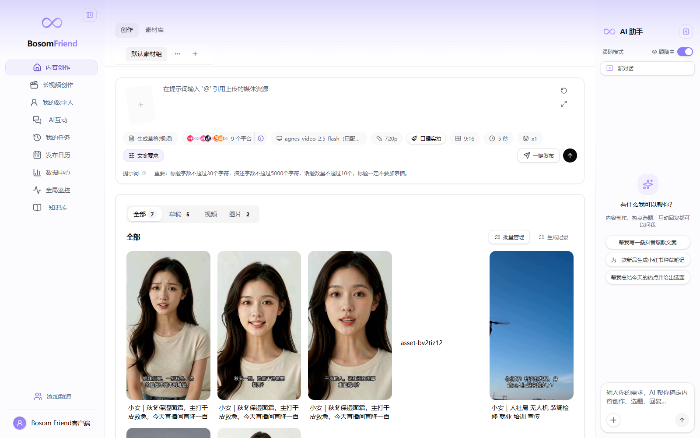

| 编号 | 区域 | 说明 |
|---|---|---|
| ① | 创作 / 素材库 | 切换创作工作台与素材管理 |
| ② | 素材组与上传区 | 默认素材组可切换；在提示词输入 `@` 可引用已上传的媒体资源 |
| ③ | 生成参数行 | 生成模式、目标平台、模型、分辨率、画面风格、画幅比例、时长、数量 |
| ④ | 文案要求 / 一键发布 | 追加写作约束；或直接对当前内容发起发布流程（详见第 5 节） |
| ⑤ | 内容列表 | 全部 / 草稿 / 视频 / 图片 四个页签，支持批量管理与查看生成记录 |

### 2.1 生成一条内容

1. 在提示词输入框描述需求，例如「秋冬保湿面霜，主打干皮救急，今天直播间直降一百」；
2. 需要素材时先上传图片 / 视频 / 音频，并在提示词中用 `@` 引用；
3. 选择生成模式（视频或图文）、目标平台、模型、分辨率、画面风格、画幅比例、时长与数量；
4. 点击「生成草稿」，生成过程中可在列表顶部看到排队 / 进度卡片；
5. 结果出现在下方内容列表，点击卡片可预览、编辑、发布或继续生成。

### 2.2 生成参数

| 参数 | 说明 |
|---|---|
| 生成模式 | 视频 / 图文两种模式，按钮上会显示当前模式，例如「生成草稿(视频)」 |
| 目标平台 | 只列出已连接且支持发布的平台（当前 9 个，详见第 6 节的能力表） |
| 模型 | 下拉只列「设置 → 自定义大模型」里配置的型号；产品不内置任何大模型，没配置时下拉会提示去设置里配置 |
| 分辨率 | 720p / 1080p（可选档位随模型而定） |
| 画面风格 | 视频风格：口播实拍 / 电影感 / 快节奏混剪 / 叙事旅行 / 产品大片 / 生活纪录；图片风格：写实 / 插画 / 水彩 / 油画 / 卡通 / 赛博朋克 / 电影感 / 极简 |
| 画幅比例 | 9:16（竖屏）/ 16:9（横屏）/ 1:1（方形），可选项随模型而定 |
| 时长 | 内容创作是**短视频**档位，单条最长 60 秒；需要 90 秒以上的整片请到「长视频创作」（第 3 节） |
| 数量 | 一次生成的条数（图片可批量出图） |
| 文案要求 | 追加写作约束（语气 / 字数 / 禁词等） |
| 参数限制 | 按所选平台列出标题 / 正文 / 话题 / 媒体数量上限（例如标题 ≤30 字、正文 ≤5000 字、话题 ≤10 个） |
| 重置配置 | 清空当前提示词与参数 |

### 2.3 素材库

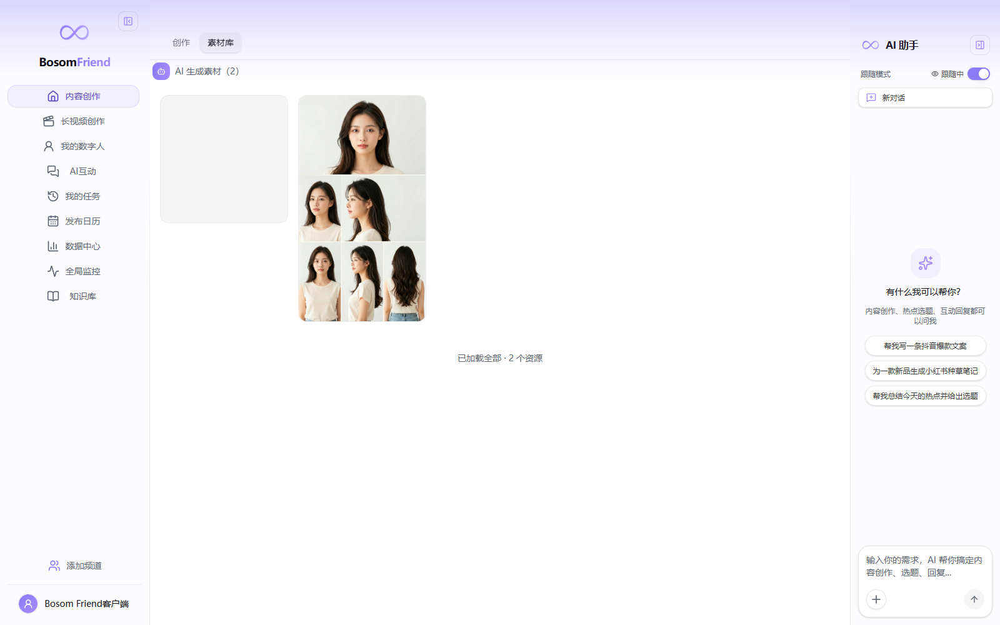

| 编号 | 区域 | 说明 |
|---|---|---|
| ① | 创作 / 素材库 | 切回创作工作台，或留在素材库管理素材 |
| ② | 素材分组标题 | 例如「AI 生成素材（2）」，按来源与分组归档，默认素材组恒排第一 |
| ③ | 素材网格 | 支持预览、批量移动、批量删除与拖拽到创作区发布 |
| ④ | 加载状态 | 例如「已加载全部 · 2 个资源」，如实显示已加载条数 |

AI 生成的图片、视频与手动上传的素材会自动归档到「素材库」；素材按「素材组」组织（默认组不可删除，组内还有内容时拒绝删组并会报出条数）。

---

## 3. 长视频创作：数字人口播与场景呈现

左侧「长视频创作」用于做**一条完整的带货长片**：厂商单次只能生成 4～12 秒，所以长视频由后端通用工作流分段生成、再拼成整条。

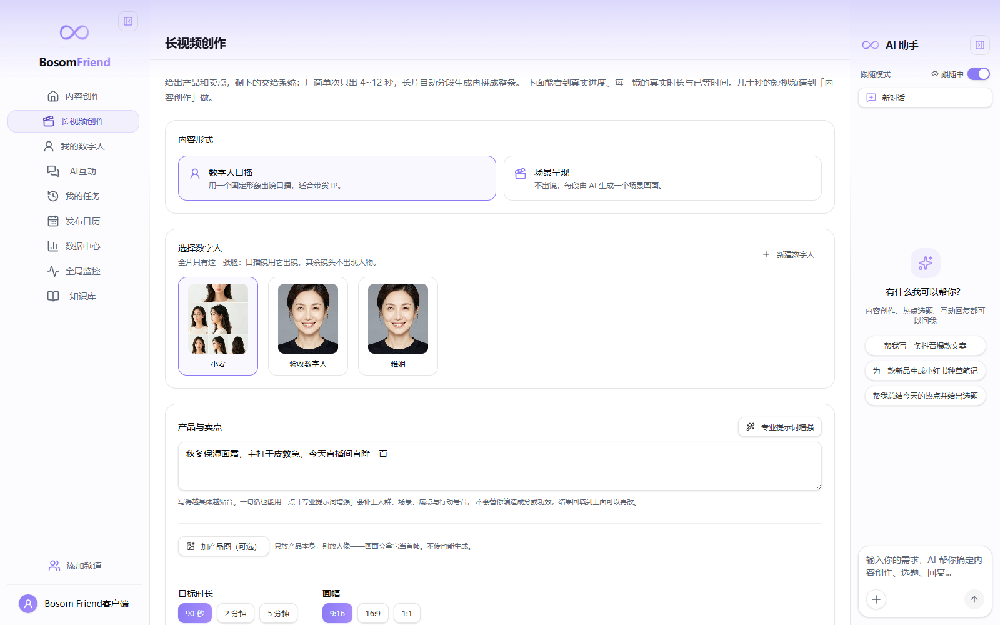

| 编号 | 区域 | 说明 |
|---|---|---|
| ① | 内容形式 | 数字人口播 / 场景呈现 二选一 |
| ② | 选择数字人 | 口播镜用这张脸出镜；右侧「新建数字人」可直接跳去创建（第 4 节） |
| ③ | 产品与卖点 | 写清产品、人群、场景、痛点与行动号召；右侧「专业提示词增强」可一键改写成创作要求 |
| ④ | 加产品图（可选） | 只放产品本身，不要放人像——画面会拿它当替身；不传也能生成 |
| ⑤ | 目标时长 | 90 秒 / 2 分钟 / 5 分钟三档 |
| ⑥ | 画幅 | 9:16 / 16:9 / 1:1（成片 1080p） |
| ⑦ | 画面字幕 | 打开后把口播文本压进画面，静音刷到也看得懂 |
| ⑧ | 开始生成 | 一次生成一整条：写稿 → 排分镜 → 逐镜生成 → 拼接 |

### 3.1 两种内容形式

- **数字人口播**：用一个固定形象出镜口播，适合做带货 IP；每次出片都是同一个人、同一个声音。全片只有这一张脸，口播镜用它出镜，其余镜头不出现人物。
- **场景呈现**：不出镜，每一段由 AI 按文案生成一个场景画面，与数字人共用同一条工作流。

### 3.2 生成一条长视频

1. 在「内容形式」里选数字人口播或场景呈现；
2. 选一个数字人（口播形式必选；没有就去「我的数字人」先建一个）；
3. 在「产品与卖点」里写清卖点，必要时点「专业提示词增强」；
4. 需要产品出镜时点「加产品图（可选）」上传产品图；
5. 选目标时长与画幅，按需打开「画面字幕」；
6. 点「开始生成」，之后可以离开这一页——任务在后端继续跑，回到本页或刷新都能看到进行中的任务。

### 3.3 生成过程与单镜重做

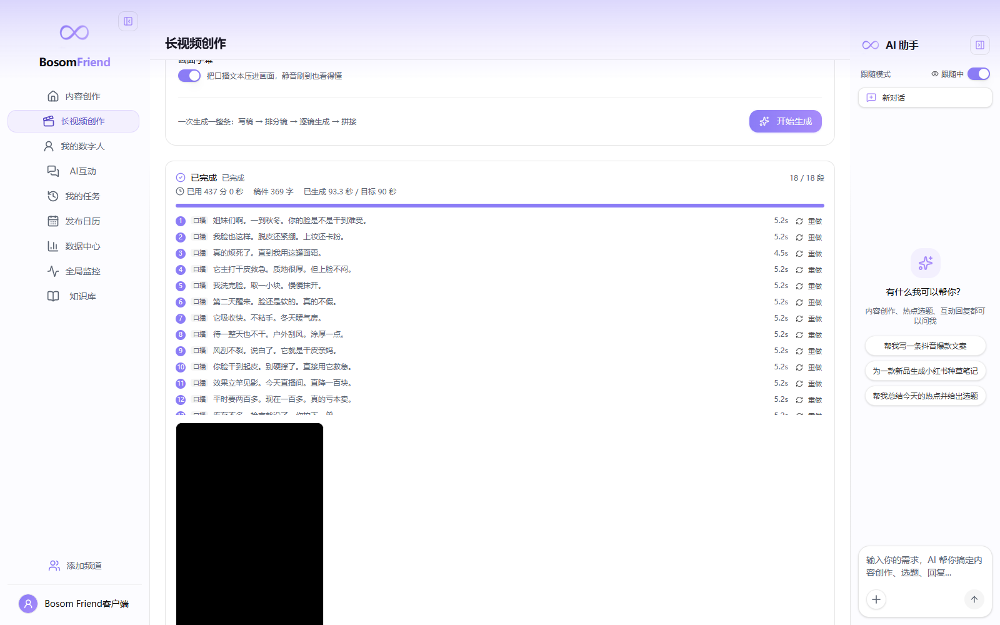

| 编号 | 区域 | 说明 |
|---|---|---|
| ① | 任务状态 | 「已完成 / 生成中」＋进度「18 / 18 段」，进度按后端真实段数推进，不按时间推算 |
| ② | 任务指标 | 已用时长、稿件字数、已生成秒数 / 目标秒数，三项都是后端真实值 |
| ③ | 分镜列表 | 每一镜的类型（口播 / 场景）、口播文本与真实时长 |
| ④ | 重做 | 只重跑这一镜，然后把整条重新拼一遍；某一镜不满意时不必整条重跑 |
| ⑤ | 成片 | 生成完成后可在本页预览，点「去草稿箱发布」进入发布流程 |

- **中断与续跑**：任务被中断（关掉应用、网络抖动）后可「继续生成」，已完成的镜头不会重跑；暂时性失败（例如厂商限流）会自动重跑这一镜并如实记录。
- **稿件与时长**：口播稿按 4.5 字/秒的语速口径换算目标字数（例如 90 秒约 405 字），成片时长与目标偏差会显示在任务指标里；卖点写得越具体，出片越接近目标时长。

### 3.4 什么内容该去哪里做

| 需求 | 去哪里 | 规格 |
|---|---|---|
| 一条短视频 / 图文笔记 | 内容创作 | 单条最长 60 秒，可批量出多条 |
| 一条完整带货长片（含数字人口播） | 长视频创作 | 90 秒 / 2 分钟 / 5 分钟，1080p，分段生成再拼接 |

---

## 4. 我的数字人

左侧「我的数字人」用于创建固定的出镜形象与声音。**形象 + 音色 + 念法**，三项定下来就是一个固定的带货 IP。

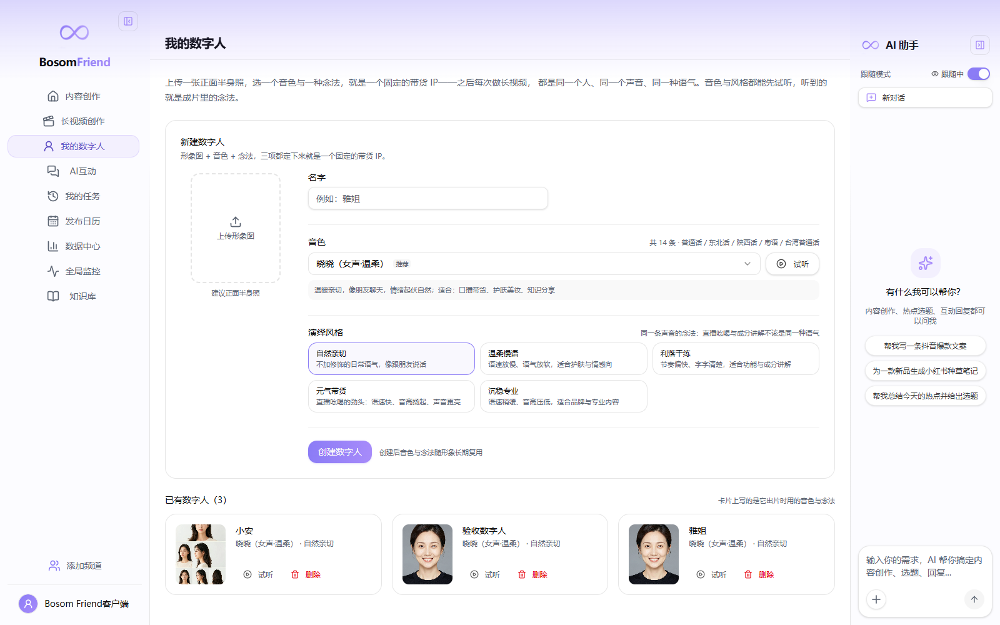

| 编号 | 区域 | 说明 |
|---|---|---|
| ① | 上传形象图 | 建议正面半身照；这张脸会用于口播镜 |
| ② | 名字 | 便于在长视频创作页里认出它，例如「雅姐」 |
| ③ | 音色 | 共 14 条（普通话 / 东北话 / 陕西方言 / 粤语 / 台湾普通话），可点「试听」 |
| ④ | 演绎风格 | 自然亲切 / 温柔慢语 / 利落干练 / 元气带货 / 沉稳专业——同一条声音的念法，直播吆喝与成分讲解不该是同一种语气 |
| ⑤ | 创建数字人 | 创建后音色与念法随形象长期复用 |
| ⑥ | 已有数字人 | 卡片上写的是它出片时用的音色与念法，可试听、可删除 |

---

## 5. 一键发布到多个平台

在内容创作页点右上角「一键发布」打开发布弹窗（发布弹窗是全应用唯一宿主，内容创作 / 发布日历 / AI 任务都复用同一个）。

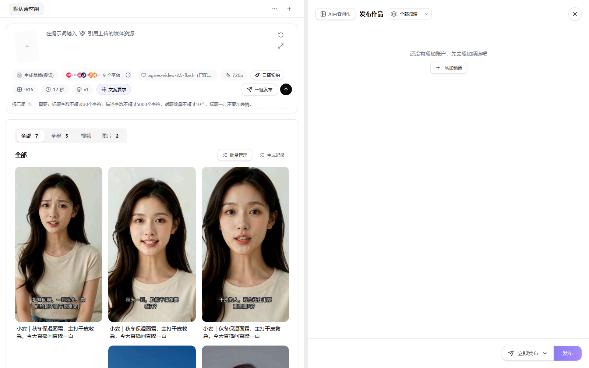

| 编号 | 区域 | 说明 |
|---|---|---|
| ① | 左侧内容管理 | 从当前内容与草稿里挑选要发布的内容，可拖拽素材直接进入发布参数 |
| ② | 顶部频道选择 | 「全部频道 / 指定频道」，与账号库同源，可多选账号 |
| ③ | 发布区 | 账号的平台参数、正文与标题、话题、封面与媒体上传、定时发布时间 |
| ④ | 空态引导 | 还没有绑定账号时，右侧直接给出「还没有添加账户，先去添加频道吧」与添加入口，不会让用户对着空白页猜 |
| ⑤ | 底部操作栏 | 发布时间（立即发布 / 定时发布）与「发布」按钮；参数不满足平台要求时先补齐再发布 |

1. 弹窗顶部选择要发布的频道与账号（与账号库同源，可多选）；
2. 尚未绑定账号时，先点「添加频道」去绑定（见第 6 节）；
3. 填写正文、标题、话题，并上传封面、图片或视频；
4. 检查各账号的平台参数与校验提示——发现问题的账号会被逐条列出（缺媒体、超字数等错误与警告）；
5. 点击「立即发布」进入发布流程，发布后可在「发布日历 / 数据中心」跟踪进度与真实数据。

> 说明：平台发送必须使用账号的真实登录态；没有登录或平台未返回作品链接时，系统会如实提示失败，不会标记为成功。发布失败提示登录失效时，账号会立即标记为「需重新登录」，并保留「重新授权」入口。

---

## 6. 绑定平台账号（频道）

在左下角点击「添加频道」，或进入频道管理后点击「连接新频道」。

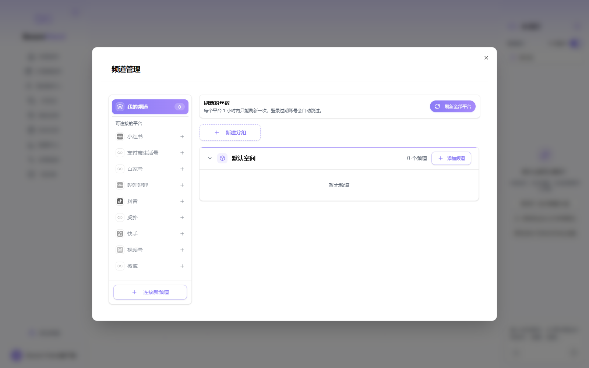

| 编号 | 区域 | 说明 |
|---|---|---|
| ① | 我的频道 | 已连接账号列表，按分组展示 |
| ② | 可连接的平台 | 当前可接入的平台清单，点右侧「＋」开始授权 |
| ③ | 刷新粉丝数 | 刷新全部平台的账号数据；同一账号 1 小时内只刷新一次，登录过期会提示重新登录 |
| ④ | 新建分组 | 按业务划分账号（例如按店铺、按项目），每个分组可独立展示与筛选 |
| ⑤ | 默认空间 | 新绑定账号默认落在这里；「添加频道」与左侧入口等价 |
| ⑥ | 连接新频道 | 打开平台选择页，进入扫码 / 浏览器授权流程 |

### 6.1 平台能力清单

连接能力与发布能力分开报告：没接通发布的平台不会出现在内容创作的目标平台里，避免「选了也发不出去」。

| 平台 | 作为频道连接 | 发布 | 账号数据 | 作品同步 | 说明 |
|---|---|---|---|---|---|
| 小红书 | ✅ | ✅ | ✅ | ✅ | 评论 / 私信接待读取覆盖 |
| 抖音 | ✅ | ✅ | ✅ | ✅ | 评论 / 私信接待读取覆盖 |
| 快手 | ✅ | ✅ | — | — | 二维码登录 |
| 视频号 | ✅ | ✅ | — | — | 二维码登录 |
| 哔哩哔哩 | ✅ | ✅ | — | — | 扫码登录 |
| 百家号 | ✅ | ✅ | — | — | 扫码登录 |
| 支付宝生活号 | ✅ | ✅ | — | — | 扫码登录 |
| 微博 | ✅ | ✅ | — | — | 扫码登录 |
| 虎扑 | ✅ | ✅ | — | — | 扫码登录 |
| 闲鱼 | 计划中 | — | — | — | 登录适配器落地后自动转为可用 |

绑定成功后，账号会自动出现在「默认空间 / 我的频道」中，并自动纳入全局监控、数据采集与评论 / 私信读取。

---

## 7. 全局监控与 7×24 自动接待

左侧导航点击「全局监控」。

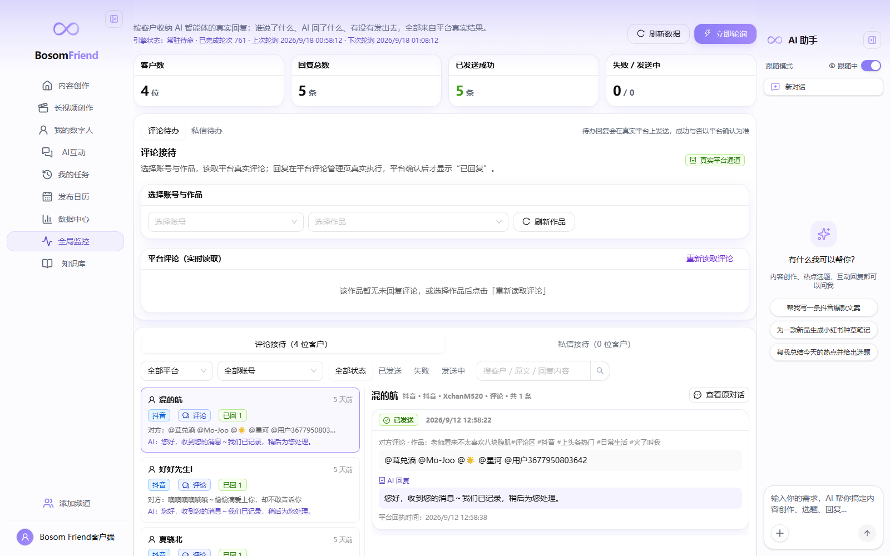

| 编号 | 区域 | 说明 |
|---|---|---|
| ① | 顶部统计卡 | 客户数、回复总数、已发送成功、失败 / 发送中 |
| ② | 评论待办 / 私信待办 | 待办回复会在真实平台上发送，成功与否以平台确认为准 |
| ③ | 评论接待 | 选择账号与作品后实时读取平台评论：「刷新作品」「重新读取评论」 |
| ④ | 接待记录 | 按全部平台 / 全部账号 / 全部状态（已发送 / 失败 / 发送中）筛选，每条显示「已回 N」 |
| ⑤ | 查看原对话 | 展开某位客户的完整往来与平台回执时间 |
| ⑥ | 引擎参数与 7×24 全自动接待 | 轮询间隔、每账号每轮上限、去重窗口、失败重试冷却；全自动开关 |
| ⑦ | 平台统一监控总览与账号级状态 | 各平台账号数与真实状态（已接入、平台风控、未登录、待接入等） |

### 7.1 接待引擎边界

当前评论与私信读取覆盖 **抖音、小红书**：

- 引擎只做真实平台只读采集，命中规则的评论 / 私信会登记为待办；
- 打开「7×24 全自动接待」后，由应用内的前端智能体自动发送；
- 关闭全自动模式时，需要你在「全局监控 → 评论 / 私信接待」中手动确认发送；
- 其他平台会明确显示「待接入 / 待官方插件」，不会伪造采集或发送结果。

---

## 8. 账号管理与接待规则

「添加频道 → 全部频道」页下方是账号管理与接待规则区。

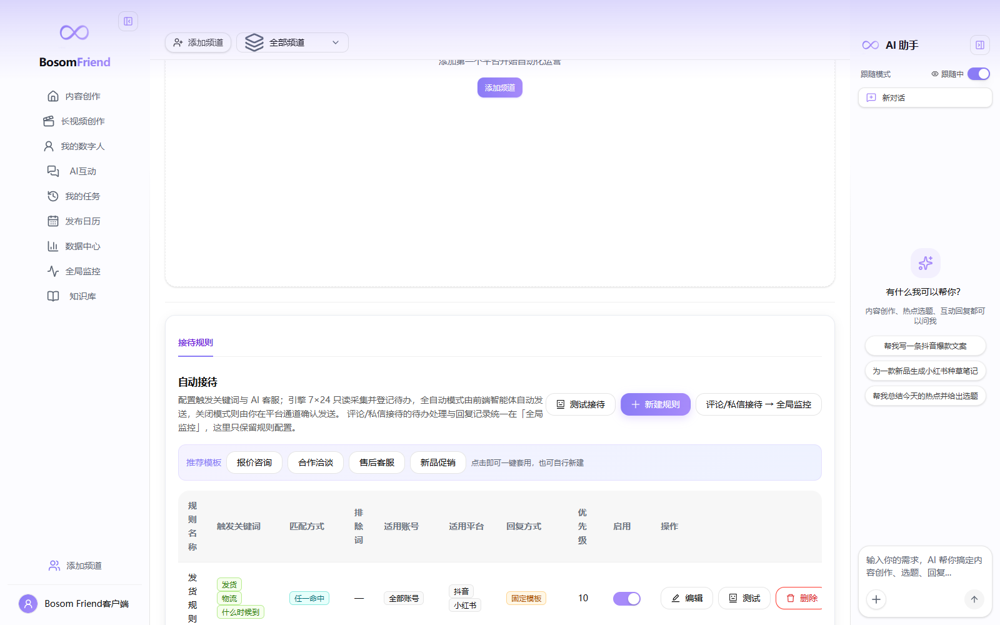

| 编号 | 区域 | 说明 |
|---|---|---|
| ① | 接待规则 | 规则列表：规则名称、触发关键词、匹配方式、排除词、适用账号、适用平台、回复方式、优先级、启用状态 |
| ② | 自动接待 | 配置触发关键词与 AI 客服；引擎 7×24 只读采集并登记待办，全自动模式由前端智能体自动发送，关闭模式则由你在「全局监控」确认发送 |
| ③ | 测试接待 | 用一句话验证规则是否命中 |
| ④ | 新建规则 | 打开新建接待规则弹窗 |
| ⑤ | 推荐模板 | 报价咨询 / 合作洽谈 / 售后客服 / 新品促销，点击即可一键套用 |
| ⑥ | 行内操作 | 每条规则可编辑、测试、删除，并可直接开关启用 |

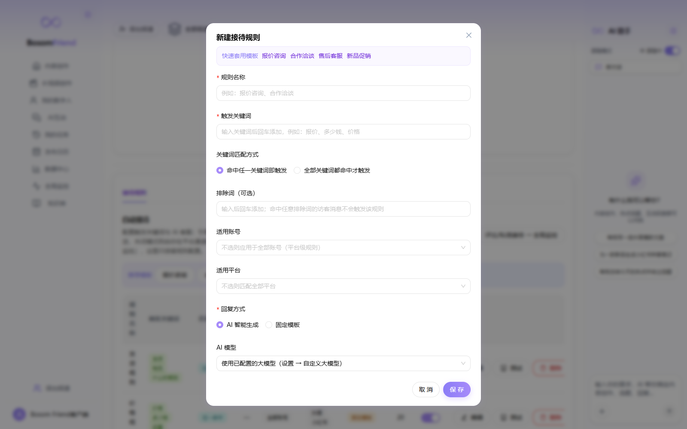

| 字段 | 说明 |
|---|---|
| 规则名称 | 自定义名称，便于识别 |
| 触发关键词 | 输入后回车添加；例如「报价、多少钱、价格」 |
| 关键词匹配方式 | 命中任一关键词即触发 / 全部关键词都命中才触发 |
| 排除词（可选） | 命中任意排除词的访客消息不会触发该规则 |
| 适用账号 | 不选则应用于全部账号（平台级规则） |
| 适用平台 | 不选则匹配全部平台 |
| 回复方式 | AI 智能生成（使用已配置的大模型）或固定模板 |
| AI 模型 | 显示「使用已配置的大模型（设置 → 自定义大模型）」 |
| 客服人设（可选） | 描述客服身份、语气与回复偏好 |
| 优先级 | 数字越小越优先；默认规则「AI 兜底接待」优先级为 999 |
| 失败重试冷却（分钟） | 失败后重新进入待办前需要等待的分钟数 |
| 启用 | 保存后立即生效，可随时开关 |

---

## 9. 数据中心

左侧导航点击「数据中心」。

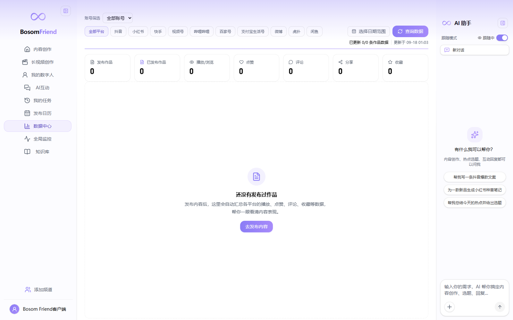

| 编号 | 区域 | 说明 |
|---|---|---|
| ① | 平台筛选 | 全部平台或单个平台（抖音、小红书、快手、视频号、哔哩哔哩、百家号、支付宝生活号、微博、虎扑、闲鱼） |
| ② | 账号筛选 | 全部账号或指定账号 |
| ③ | 日期范围与查询 | 选择日期范围后点「查询数据」 |
| ④ | 更新状态 | 例如「已更新 0/0 条作品数据 · 更新于 09-18 01:12」，如实显示本次更新了多少条 |
| ⑤ | 核心指标卡 | 发布作品、已发布作品、播放 / 浏览、点赞、评论、分享、收藏 |
| ⑥ | 空态引导 | 还没有发布过作品时给出「去发布内容」入口 |

> **数据诚实性**：平台本次没有返回的指标会标注「本次未采到…可重新同步」，不会把 0 当作真实数据展示；更新状态会如实说明「已更新 N/M 条作品数据（另有 X 条平台本次只回了 0，未采到真值）」。

---

## 10. 发布日历

左侧导航点击「发布日历」。

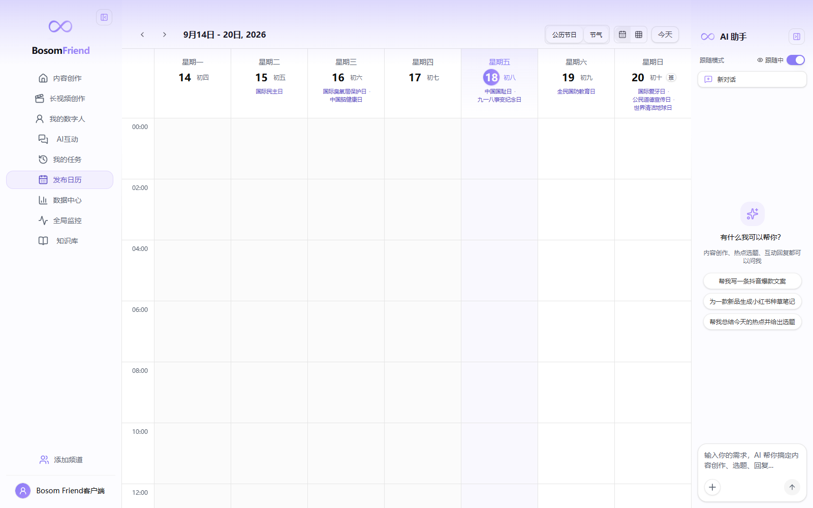

| 编号 | 区域 | 说明 |
|---|---|---|
| ① | 周期标题 | 当前周与日期范围，例如「9月14日 - 20日, 2026」 |
| ② | 视图开关 | 公历节日 / 节气 显示开关，以及「今天」快速回到当周 |
| ③ | 日视图列 | 星期、公历日期、农历日期与当天节日 / 节气 |
| ④ | 时间轴 | 00:00 ～ 22:00 的小时刻度，排期作品按发布时间落在轴上 |
| ⑤ | 今天高亮 | 「今天」列有独立底色与「班」等工作日标记 |

支持周视图 / 月视图、公历节日与节气显示；点击日期或作品可查看详情，「新建作品」可排期发布；桌面端可直接拖拽调整发布时间。

---

## 11. AI 互动：热点内容与评论搜索

左侧导航点击「AI互动」，上方包含 **热点内容 / 评论搜索** 两个标签。

### 11.1 热点内容

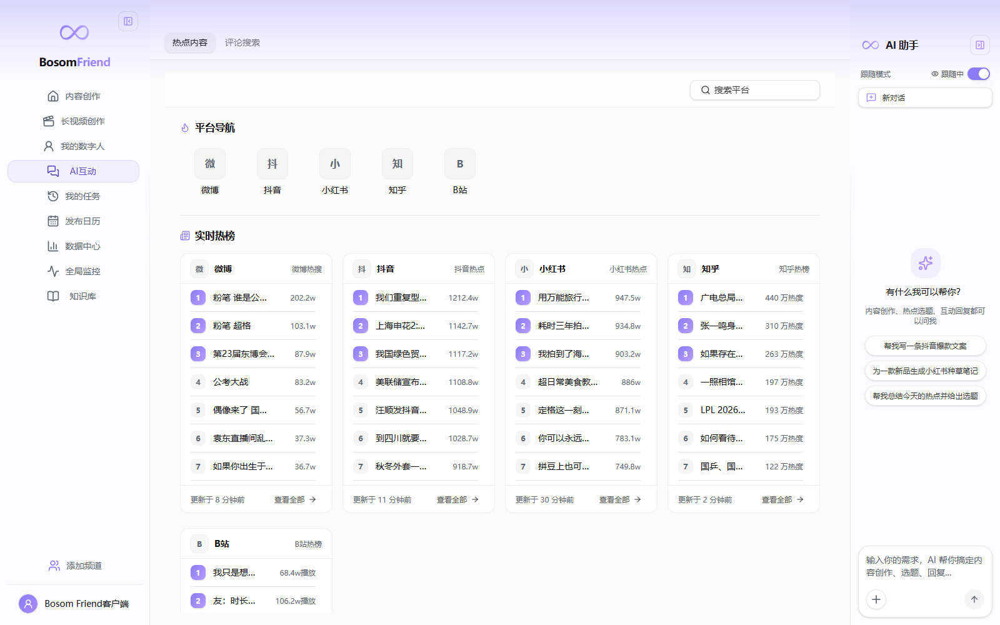

| 编号 | 区域 | 说明 |
|---|---|---|
| ① | 平台导航 | 微博、抖音、小红书、知乎、B站，点击切换平台 |
| ② | 搜索平台 | 按平台名快速定位榜单 |
| ③ | 实时热榜 | 每个平台一列，按热度排序，带热度值（例如 173.7w） |
| ④ | 打开原文 | 每条热点可直接打开原文查看详情 |
| ⑤ | 更新时间与查看全部 | 例如「更新于 8 分钟前 · 查看全部」 |

结合右侧 AI 助手，可以让 AI「总结今天的热点并给出选题」。

### 11.2 评论搜索

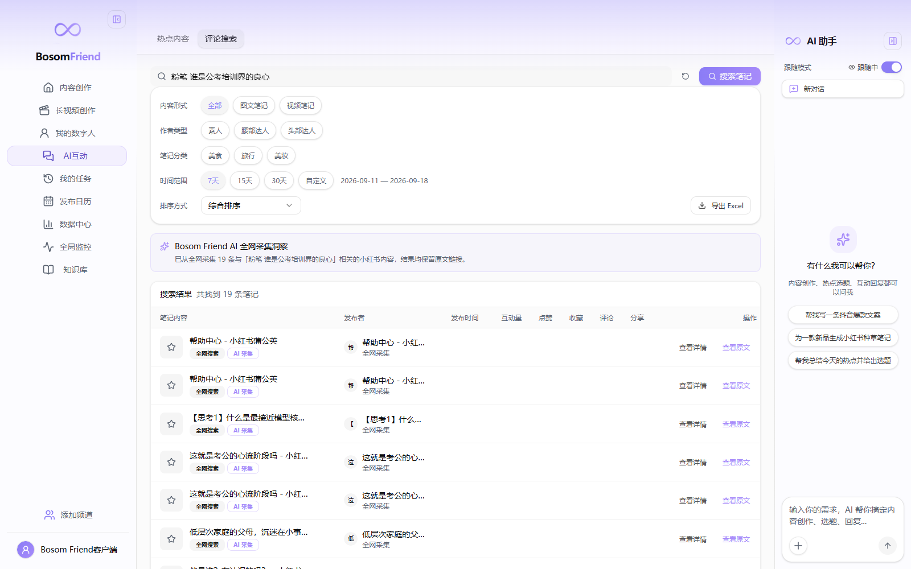

| 编号 | 区域 | 说明 |
|---|---|---|
| ① | 搜索框 | 输入品牌词、产品名或评论高频词，点「搜索笔记」 |
| ② | 内容形式 | 全部 / 图文笔记 / 视频笔记 |
| ③ | 作者类型 | 素人 / 腰部达人 / 头部达人 |
| ④ | 笔记分类 | 美食、旅行、美妆等；时间范围：7 天 / 15 天 / 30 天 / 自定义（带日期区间） |
| ⑤ | 排序方式 | 综合排序等 |
| ⑥ | 导出 Excel | 按当前筛选条件导出结果，用于竞品分析与选题策划 |
| ⑦ | 采集洞察 | 例「已从全网采集 19 条与…相关的小红书内容，结果均保留原文链接」 |
| ⑧ | 结果表格 | 笔记内容 / 发布者 / 发布时间 / 互动量 / 点赞 / 收藏 / 评论 / 分享，操作为「查看详情」「查看原文」 |

---

## 12. 我的任务

左侧导航点击「我的任务」，这里是所有 AI 对话与生成任务的记录。

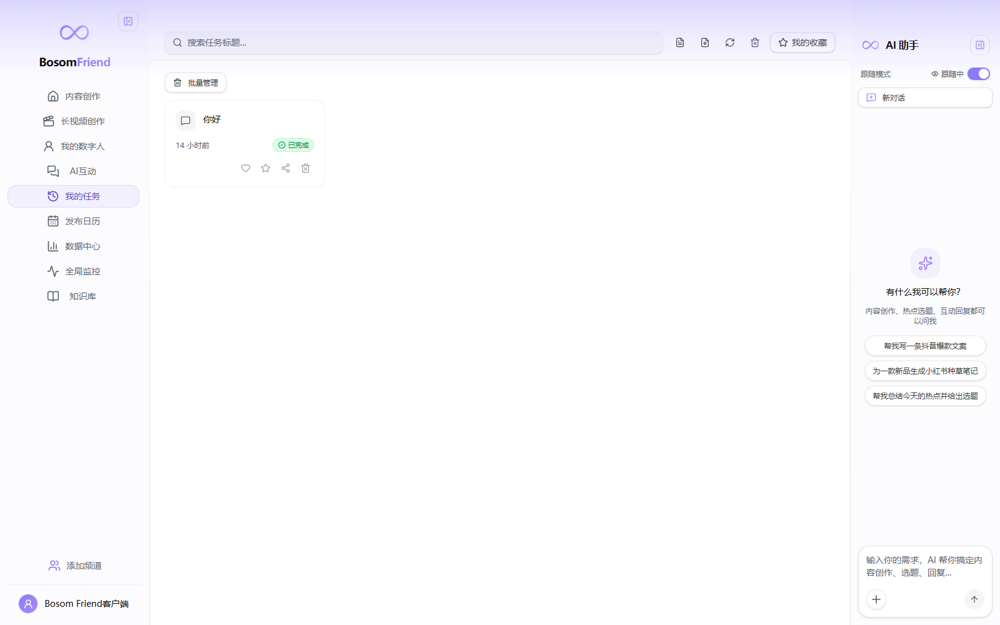

| 编号 | 区域 | 说明 |
|---|---|---|
| ① | 搜索任务标题 | 按标题检索历史任务 |
| ② | 批量管理 | 勾选多条任务一次性删除 |
| ③ | 我的收藏 | 只看收藏过的任务 |
| ④ | 任务卡片 | 任务标题、时间（例如「14 小时前」）与状态（已完成 / 进行中等），卡片下方可收藏、评分、分享、删除 |

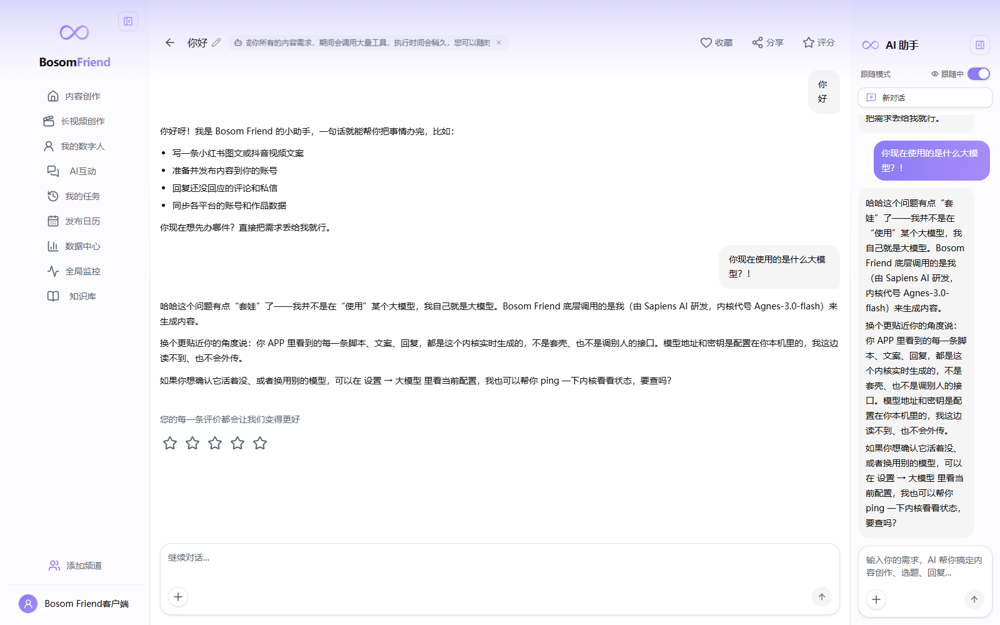

| 编号 | 区域 | 说明 |
|---|---|---|
| ① | 任务标题与执行说明 | 「Agent 来完成你所有的内容需求，期间会调用大量工具，执行时间会偏长」 |
| ② | 对话与执行过程 | AI 的完整回复与工具调用结果，执行中实时流式输出 |
| ③ | 评分 | 五星评分，评价会反馈给产品 |
| ④ | 继续对话 | 在任务里继续追问，不必重新开始 |
| ⑤ | 收藏 / 分享 | 收藏任务或生成只读分享链接 |

> 删除任务时会一并回收它的分享链接，不再留下打不开的只读页；删除草稿 / 素材 / 任务时，若目标已不存在，界面会如实说明，不会谎报「删除成功」。

---

## 13. 知识库

左侧导航点击「知识库」（仅桌面端启用）。

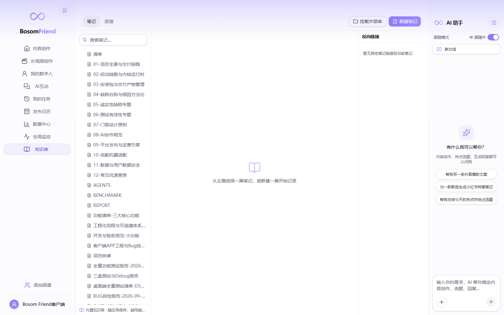

| 编号 | 区域 | 说明 |
|---|---|---|
| ① | 笔记 / 蒸馏 | 笔记用于日常编辑；「蒸馏」把资料提炼成可复用的知识条目 |
| ② | 目录树 | 左侧列出全部笔记，支持全库搜索 |
| ③ | 新建笔记 / 挂载外部库 | 右上角入口；可把外部目录作为知识库挂载进来 |
| ④ | 编辑区 | 支持 Markdown 编辑 / 预览，输入停止后自动保存 |

- 内置知识库随应用保存的运营知识（平台发布指南、创作方法论、接待话术、爆款方法等），AI 会自动参考，越用越聪明；
- 笔记支持 `[[双链]]` 反向链接，形成网状知识结构；内置文档不可删除。

> 网页版未挂载桌面本地能力时，知识库页面会提示「仅在桌面端可用」；Windows 桌面端打开后即可正常编辑。

---

## 14. 右侧 AI 助手

每个页面右侧都有常驻 **AI 助手面板**。

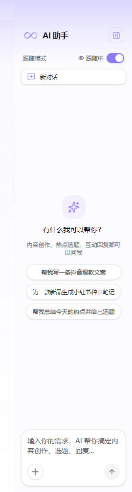

| 编号 | 区域 | 说明 |
|---|---|---|
| ① | 跟随模式 | 打开后助手跟随当前页面的上下文（例如任务详情里的对话）；可随时关闭 |
| ② | 新对话 | 开始一段全新会话 |
| ③ | 快捷指令 | 「帮我写一条抖音爆款文案」「为一款新品生成小红书种草笔记」「帮我总结今天的热点并给出选题」 |
| ④ | 输入框 | 直接输入需求：内容创作、热点选题、互动回复都可以问；左侧「＋」可附带素材 |

- 右侧助手是**临时会话**：每次启动应用自动清理，一段会话内的刷新会保留；长期数据保存在「我的任务」里，需要时从任务记录重新进入即可查看完整历史；
- 未配置自己的大模型 API 时，面板使用内置模板兜底并提示配置入口，不会伪造真实模型结果。

---

## 15. 设置中心

点击左下角「Bosom Friend 客户端」→「设置」进入，共四个分区：**通用设置 / 自定义大模型 / 系统与更新 / 远程访问**。

### 15.1 通用设置

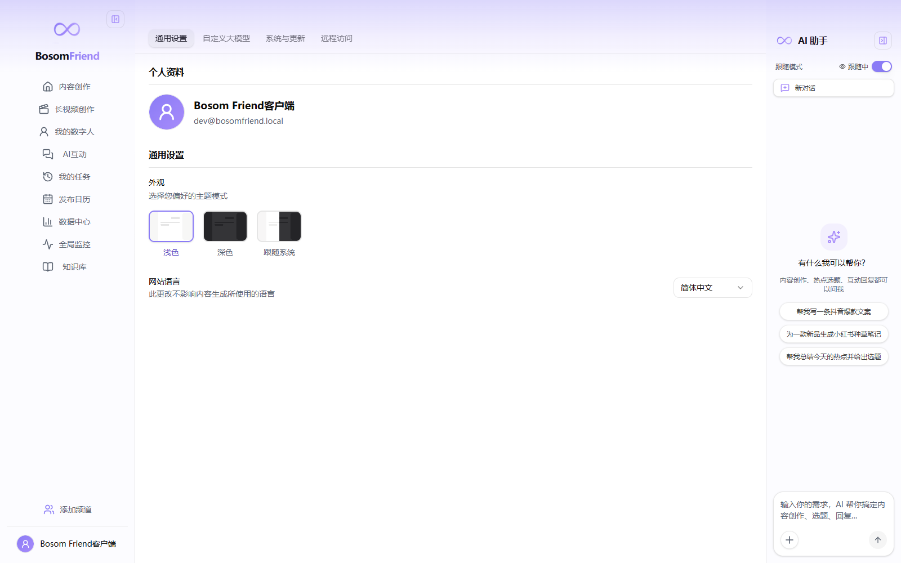

| 分区 | 功能 |
|---|---|
| 个人资料 | 昵称、头像与登录账号（本机账号，例如 dev@bosomfriend.local） |
| 外观 | 浅色 / 深色 / 跟随系统 |
| 网站语言 | 界面语言（此更改不影响内容生成所使用的语言） |

### 15.2 自定义大模型（重要）

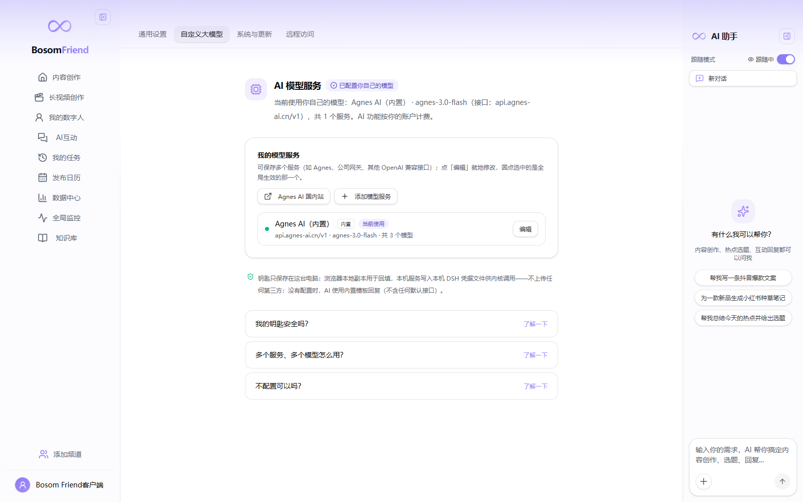

| 编号 | 区域 | 说明 |
|---|---|---|
| ① | 当前状态 | 「已配置你自己的模型」并显示当前使用的服务与型号；未配置时显示内置模板模式 |
| ② | 我的模型服务 | 可保存多个服务（例如 Agnes、公司网关、其他 OpenAI 兼容接口），每个服务可保存多个模型 |
| ③ | 添加模型服务 | 新增一个服务；「Agnes AI 国内站」是官方推荐的领取入口 |
| ④ | 服务条目 | 显示接口地址、型号与模型数量；「内置」表示随应用提供，「当前使用」表示全局生效 |
| ⑤ | 编辑 | 修改接口地址、API Key、模型名；可「自动获取可用模型」并逐个设置显示名称 |
| ⑥ | 安全说明 | 钥匙只保存在这台电脑，浏览器副本本地保留用于回填，本机服务写入本机 DSH 凭据文件，不上传任何第三方；没有配置时 AI 使用内置模板回复（不含任何默认接口） |

1. 点「添加模型服务」，在编辑区点「Agnes AI 国内站」到 `https://platform.agnes-ai.cn/` 注册并创建 API Key（按量计费）；
2. 填写 API 接口地址、你的 API Key、你的模型名称；
3. 不确定模型名时点「自动获取可用模型」，拉取到的模型点一下即可加入模型列表；
4. 保存后立即生效，无需重启；模型以标签形式列出，点标签即可切换当前对话模型；
5. 在服务列表里点「设为当前」切换全局生效的那一个；删完最后一个即恢复内置模板模式；
6. 图片 / 视频模型为选填：同厂商可复用当前服务的 Key，其他厂商可分别填写接口、Key 与模型名。

> 🔒 安全说明：密钥保存在本机用户目录，不会随安装包分发；模型配置的每次写入都会留审计日志，清空配置需显式确认，不会因一次误操作整份丢失。

### 15.3 系统与更新

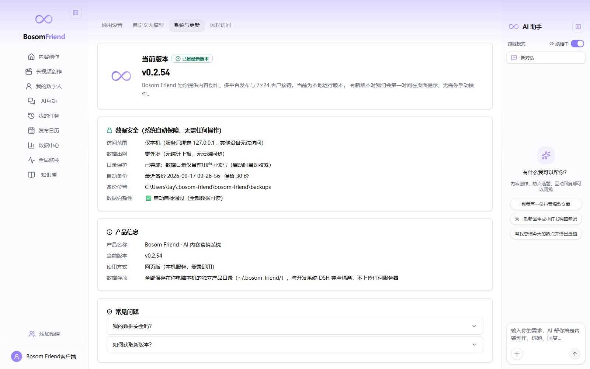

| 编号 | 区域 | 说明 |
|---|---|---|
| ① | 当前版本 | 例如 v0.2.54，并显示「已是最新版本 / 有新版本」 |
| ② | 数据安全 | 访问范围（仅本机，服务只绑定 127.0.0.1）、数据出网（零外发：无统计上报、无云端同步）、目录保护（数据目录仅当前用户可读写）、自动备份（份数与最近备份时间）、数据完整性（启动自检） |
| ③ | 产品信息 | 产品名称、当前版本、使用方式与数据存放位置 |
| ④ | 常见问题 | 「我的数据安全吗？」「如何获取新版本？」等展开式答疑 |

- 数据保存在本机产品目录 `~/.bosom-friend/`（安装版与开发系统 DSH 完全隔离），启动时自动备份，卸载应用不会删除这部分用户数据；
- 桌面端在「设置 → 系统与更新」中检查更新并安装，升级后数据与账号配置保留。

### 15.4 远程访问

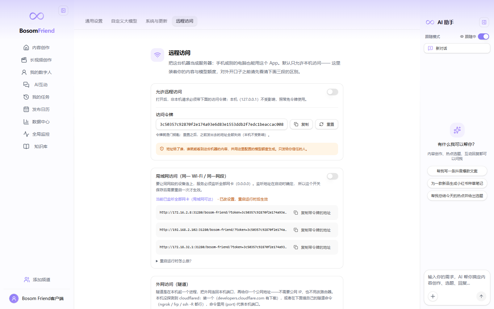

| 编号 | 区域 | 说明 |
|---|---|---|
| ① | 允许远程访问 | 打开后，非本机请求必须带下面的访问令牌；本机（127.0.0.1）不受影响 |
| ② | 访问令牌 | 一键复制或重置；令牌就是钥匙，重置后此前发出的地址全部失效（本机不受影响） |
| ③ | 局域网访问 | 同一 Wi-Fi / 同一网段内的设备通过局域网地址访问；需要监听全部网卡（0.0.0.0），改设置后**重启运行时**才生效 |
| ④ | 外网访问（隧道） | 用 cloudflared 等隧道把本机端口映射到公网地址，不需要公网 IP；也可自定义隧道命令，隧道进程可随时启停 |
| ⑤ | 安全提示 | 把地址发给谁，谁就能看到这台机器上的内容，并消耗这台机器配置的模型额度 |

---

## 16. 常见问题 FAQ

**Q1：启动很慢 / 卡在启动画面？**
首次启动需要初始化本地数据并解压内置运行时，受系统安全扫描影响可能需要 1~3 分钟（低配机最长约 4 分钟）；启动页会显示真实阶段与百分比，能看出「在动」还是「卡死」。低配模式会自动降载，后续启动明显更快。

**Q2：装好后打不开 / 提示「内核运行时解压失败」？**
安装不再依赖系统解压工具与系统设置（自带解压器 + 自动开启 Windows 长路径支持）。若仍出现该提示，重新运行安装包完成修复安装即可。

**Q3：大模型 API Key 从哪里申请？**
设置 → 自定义大模型 → 在服务编辑区点「Agnes AI 国内站」，地址 `https://platform.agnes-ai.cn/`（按量计费）。系统不内置任何默认 Key。

**Q4：当前支持哪些平台？**
可连接频道：小红书、抖音、快手、视频号、哔哩哔哩、百家号、支付宝生活号、微博、虎扑；其中**账号数据与作品同步**覆盖小红书与抖音，**评论 / 私信接待读取**覆盖抖音与小红书。闲鱼为计划平台，登录适配器落地后自动转为可用。

**Q5：为什么评论 / 私信没有自动发出？**
安全设计是「只读采集 + 前端显式发送」。引擎只登记待办；你要么打开「7×24 全自动接待」，要么在「全局监控 → 评论 / 私信接待」页手动确认发送。

**Q6：绑定的账号安全吗？会不会被封？**
应用使用真实平台登录态，带轮询间隔、去重窗口、失败冷却与风控状态提示（平台风控、需重新登录等状态会在账号页如实显示）。请按平台规则正常量级使用，避免短时间内高频操作。

**Q7：数据存在哪里？**
账号、作品、任务、素材与知识库都保存在本机产品目录 `~/.bosom-friend/`，不与开发系统混用，并有启动备份。卸载应用不会删除这部分用户数据。

**Q8：如何升级新版本？**
桌面端在「设置 → 系统与更新」中检查更新并安装；升级安装包下载完成后重启即完成升级，数据与账号配置会保留。

**Q9：知识库为什么打不开？**
知识库依赖桌面端本地文件能力。网页版提示不可用时，请使用 Windows 桌面端打开。

**Q10：长视频为什么要跑很久？**
厂商单次只生成 4～12 秒，一条 90 秒的片子要串行生成十几到二十几镜，再逐镜拼接；进度按真实段数显示，某一镜限流或失败会自动重跑这一镜，不必整条重来。稿件字数与目标时长不匹配时会补写，卖点写得越细越接近目标时长。

---

*本手册基于 v0.2.54（2026-09-17 发布）实机截图整理，界面细节可能随版本迭代略有差异。*
